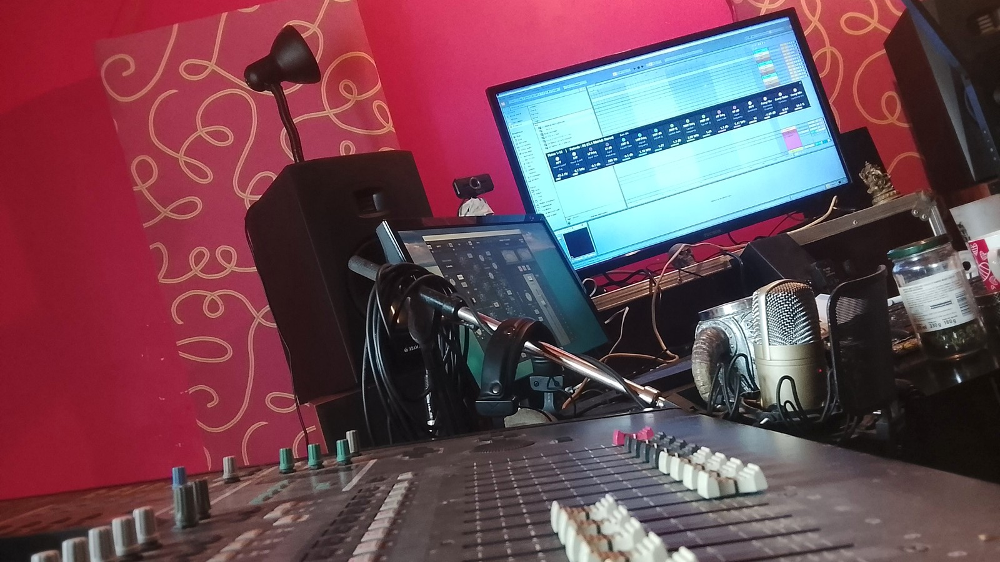

# Yamaha 02R V2 → surface de contrôle pour Ableton Live 12

*[English version: README.md](README.md)*

Transformez une console numérique **Yamaha 02R V2** des années 90 en vraie surface de contrôle pour **Ableton Live 12** : faders motorisés qui suivent Live, potards pour le pan, les sends, l'EQ et la réverbe, changement de banques, un kit d'étiquettes de couleur, et une fenêtre d'état en direct sur le PC. En bonus, un script transforme les 16 pads d'un **Arturia KeyLab Essential mk3** en boutons d'enregistrement et de navigation.

## Contenu

| Dossier | Contenu |
| --- | --- |
| `remote-scripts/Yamaha02R` | Remote Script de la 02R (Python, Ableton Live 12) |
| `remote-scripts/KeyLabPads` | Remote Script des pads du KeyLab Essential mk3 |
| `status-window` | Fenêtre d'état pour Windows (PowerShell, rien à installer), lanceur et icône |
| `keylab-template` | Template Arturia MIDI Control Center pour les pads |
| `labels` | Étiquettes à imprimer (PDF et PNG 300 dpi) et antisèche en texte |

## Prérequis

- Ableton Live 12 (testé sous Windows 10)
- Yamaha 02R V2 avec la **couche Remote** réglée sur la cible **General MIDI**
- Une interface MIDI entre la console et le PC (entrée et sortie)
- En option : Arturia KeyLab Essential mk3
- Le mode EQ cherche, sur la piste sélectionnée, un plugin dont le nom contient **MIXHUB** ou **SSL**

## Installation

1. Fermez Live.
2. Copiez le dossier `Yamaha02R` (et `KeyLabPads` si vous le voulez) dans `Documents\Ableton\User Library\Remote Scripts\`.
3. Lancez Live, ouvrez **Réglages > Link, Tempo & MIDI**.
4. Dans un emplacement **Control Surface** libre, choisissez **Yamaha02R**, avec en entrée et en sortie l'interface MIDI reliée à la console.
5. Pour les pads : chargez le template de `keylab-template` dans le KeyLab avec le MIDI Control Center, puis choisissez **KeyLabPads** dans un autre emplacement, entrée = port **MIDI** du KeyLab, sortie = aucune.

## Commandes de la 02R

| Commande | Action |
| --- | --- |
| Faders 1-16 | Volume de la piste (les moteurs suivent Live) |
| Potards 1-16 | Selon le mode des potards (voir plus bas) |
| ON 1-16 | Mute (toujours muter depuis la console, son voyant fait foi) |
| SEL 1-16 | Sélectionne la piste, ouvre le plugin d'EQ, potards en mode EQ |
| SEL double appui | Arme la piste |
| ON 19 / ON 20, flèches | Banque de 16 pistes précédente / suivante |
| ON 21 | Fait défiler les modes : Pan → Send A → B → C → EQ → Retour A → B → C → Plugin |
| LOW/HPF, L-MID, H-MID, HIGH/LPF | Accès direct : EQ, Retour A, Retour B, Retour C |
| ON de la section EQ | Potards sur le plugin sélectionné dans Live (tout VST) |
| Molette | Réglage fin du dernier réglage touché |
| ON du Master = **SHIFT** | Maintenu : décalage d'une piste, solo avec SEL, 2e page des potards (réglages 17 à 32), avec ON 21 : suivi de sélection. Seul : retour à la piste 1 |

Les numéros des ON suivent la sérigraphie de la console (les voies 17-18 forment une paire stéréo hors série).

En modes Retour et Plugin, le potard *n* pilote le *n*-ième réglage configuré dans le plugin avec le bouton **Configurer** de Live. Configurez-les dans le même ordre que vos étiquettes.

## Fenêtre d'état

Double-cliquez sur `status-window/Lancer_Fenetre02R.bat`. Une petite fenêtre noire, toujours au premier plan, affiche la banque, le mode des potards et vos 16 pistes (nom, couleur Live, MUTE/REC, piste sélectionnée). En modes EQ, Retour et Plugin, elle bascule sur les 16 potards, avec la couleur de leur étiquette, le nom du réglage, sa valeur et une barre de niveau. On la déplace en glissant la zone du haut et on la redimensionne avec la poignée du coin (un mode compact s'active quand elle est très petite). Taille et position sont mémorisées.

Le script envoie son état en UDP sur `127.0.0.1:9002` uniquement : rien ne sort du PC.

## Pads du KeyLab mk3

Template : pads en notes Gate sur le **canal MIDI 16**, de C1 à D#2 (notes 36 à 51).

| Banque A : j'enregistre | Banque B : je me déplace |
| --- | --- |
| A1 Enregistrement | B1 Ajouter / supprimer un marqueur |
| A2 Capture MIDI | B2 Marqueur précédent |
| A3 Métronome | B3 Marqueur suivant |
| A4 Boucle | B4 Armer la piste sélectionnée |
| A5 Annuler | B5 Piste précédente |
| A6 Rétablir | B6 Piste suivante |
| A7 Overdub MIDI | B7 Retour au début |
| A8 Tap tempo | B8 Réactiver l'automation |

## Kit d'étiquettes (optionnel)

Pratique si votre console n'a pas d'écran à côté. `labels` contient des bandes de couleur pour les potards, avec un code inspiré des consoles SSL : filtres en blanc, grave en marron, bas-médium en bleu, haut-médium en vert, aigu en rouge, niveaux en jaune, compresseur en orange, réverbe en violet. La bande du haut sert à l'EQ, celle du bas à une réverbe sur le Retour A (ici la SSL FlexVerb). Plus des étiquettes pour les boutons de navigation et de modes, et un mémo SHIFT.

## Limites connues

- La 02R ignore les SysEx qu'on lui envoie : son écran ne peut pas afficher les infos de Live (d'où la fenêtre sur le PC).
- La fenêtre d'état fonctionne uniquement sous Windows.
- Conçu et testé sur une seule console et un seul studio : retours et améliorations bienvenus.

## Crédits

Réalisé par **Aelvn**, musicien et bricoleur, avec l'aide de Claude (Anthropic). Licence MIT : utilisez-le, adaptez-le, partagez-le.
