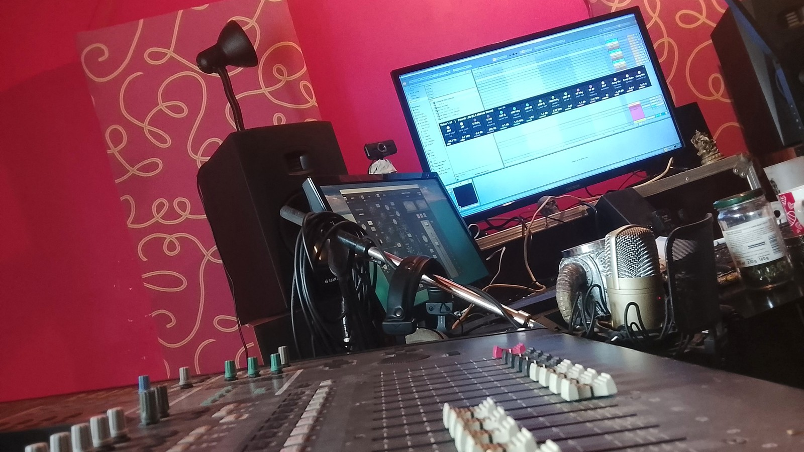

# Yamaha 02R V2 → Ableton Live 12 control surface

*[Version française : README.fr.md](README.fr.md)*

Turn a 1990s **Yamaha 02R V2** digital console into a full control surface for **Ableton Live 12**: motorized faders that follow Live, knobs for pan, sends, EQ and reverb, bank switching, a colour-coded label kit, and a live status window on your PC. A bonus script turns the 16 pads of an **Arturia KeyLab Essential mk3** into recording and navigation buttons.

## What's inside

| Folder | Content |
| --- | --- |
| `remote-scripts/Yamaha02R` | Remote Script for the 02R (Python, Ableton Live 12) |
| `remote-scripts/KeyLabPads` | Remote Script for the KeyLab Essential mk3 pads |
| `status-window` | Status window for Windows (PowerShell, nothing to install), launcher and icon |
| `keylab-template` | Arturia MIDI Control Center template for the pads |
| `labels` | Printable labels (PDF and 300 dpi PNG) and a text cheat sheet |

## Requirements

- Ableton Live 12 (tested on Windows 10)
- Yamaha 02R V2 with its **Remote layer** set to the **General MIDI** target
- A MIDI interface between the console and the PC (in and out)
- Optional: Arturia KeyLab Essential mk3
- The EQ mode looks for a plugin whose name contains **MIXHUB** or **SSL** on the selected track

## Installation

1. Close Live.
2. Copy the `Yamaha02R` folder (and `KeyLabPads` if you want it) into `Documents\Ableton\User Library\Remote Scripts\`.
3. Start Live, open **Settings > Link, Tempo & MIDI**.
4. In a free **Control Surface** slot, choose **Yamaha02R**, with the input and output of the MIDI interface connected to the console.
5. For the pads: load the template from `keylab-template` into the KeyLab with the MIDI Control Center, then choose **KeyLabPads** in another slot, input = the KeyLab **MIDI** port, output = none.

## 02R controls

| Control | Action |
| --- | --- |
| Faders 1-16 | Track volume (motors follow Live) |
| Knobs 1-16 | Depends on the knob mode (below) |
| ON 1-16 | Mute (always mute from the console, its LED is the reference) |
| SEL 1-16 | Select the track, open the EQ plugin, knobs in EQ mode |
| SEL double press | Arm the track |
| ON 19 / ON 20, arrows | Previous / next bank of 16 tracks |
| ON 21 | Cycle knob modes: Pan → Send A → B → C → EQ → Return A → B → C → Plugin |
| LOW/HPF, L-MID, H-MID, HIGH/LPF | Direct access: EQ, Return A, Return B, Return C |
| EQ section ON | Knobs on the plugin selected in Live (any VST) |
| Data wheel | Fine adjustment of the last touched parameter |
| Master ON = **SHIFT** | Held: 1-track bank moves, solo with SEL, knob page 2 (parameters 17-32), with ON 21: selection follow. Alone: back to track 1 |

ON numbers follow the console's physical labels (channels 17-18 are a stereo pair outside the series).

In Return and Plugin modes, knob *n* controls the *n*-th parameter you configured in the plugin with Live's **Configure** button. Configure them in the same order as your labels.

## Status window

Double-click `status-window/Lancer_Fenetre02R.bat`. A small always-on-top black window shows the current bank, the knob mode and your 16 tracks (name, Live colour, MUTE/REC, selected track). In EQ, Return and Plugin modes it switches to the 16 knobs, with their label colour, parameter name, value and a level bar. Drag the top area to move it, use the corner grip to resize it (a compact mode kicks in when it is very small). Size and position are remembered.

The script sends its state over UDP on `127.0.0.1:9002` only, nothing leaves the PC.

## KeyLab mk3 pads

Template: pads as Gate notes on **MIDI channel 16**, C1 to D#2 (notes 36-51).

| Bank A: record | Bank B: navigate |
| --- | --- |
| A1 Record | B1 Add / delete marker |
| A2 Capture MIDI | B2 Previous marker |
| A3 Metronome | B3 Next marker |
| A4 Loop | B4 Arm selected track |
| A5 Undo | B5 Previous track |
| A6 Redo | B6 Next track |
| A7 MIDI overdub | B7 Back to start |
| A8 Tap tempo | B8 Re-enable automation |

## Label kit (optional)

Handy if your console has no screen next to it. `labels` contains colour-coded strips for the knobs, using SSL-style colours: filters white, low brown, low-mid blue, high-mid green, high red, levels yellow, compressor orange, reverb purple. The top strip is for the EQ, the bottom one for a reverb on Return A (SSL FlexVerb here). Plus labels for the navigation and mode buttons and a SHIFT memo.

## Known limitations

- The 02R ignores the SysEx sent to it, so its own screen cannot display Live's information (hence the PC window).
- The status window is Windows only.
- Built and tested on one console and one studio: feedback and improvements are welcome.

## Credits

Made by **Aelvn**, musician and tinkerer, with the help of Claude (Anthropic). MIT licence: use it, adapt it, share it.
